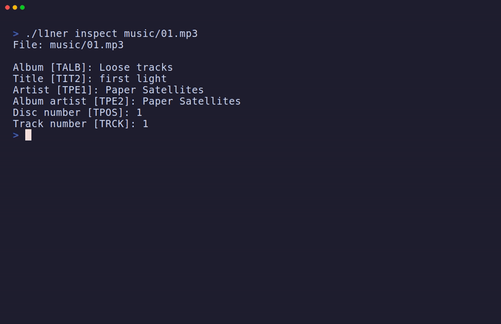

# l1ner

**Give your music its identity back.**

l1ner is an open-source Linux CLI for your local MP3 collection. Identify songs with
missing or incorrect tags, review the proposed corrections, and sort your songs
into album folders. The tags live in the MP3s, so they travel with your music.

[Install](#install) · [Quickstart](#quickstart) · [Identify by sound](#identify-by-sound) · [Command guide](docs/usage.md)



## Install

**Download a binary.** When a Linux x86-64 release is available, download its
`linux-amd64.tar.gz` archive and `SHA256SUMS` into the same directory. Verify
and unpack the archive using the filename you downloaded. The commands below
use v0.1.0. [GitHub Releases](https://github.com/palharez/l1ner/releases)

```sh
sha256sum -c SHA256SUMS
tar -xzf l1ner-v0.1.0-linux-amd64.tar.gz
./l1ner --help
```

**Build from source.** On Linux with Go 1.27.3 installed, clone the repository
and build the executable.

```sh
git clone https://github.com/palharez/l1ner.git
cd l1ner
go build -o l1ner .
./l1ner --help
```

## Quickstart

Replace the example paths with your own. Use a Linux terminal for the
interactive reviews and work on a copy of your music for your first edits and
moves.

### 1. Inspect your tags

```sh
./l1ner inspect music/song.mp3
./l1ner inspect --recursive music/
```

Inspection works offline. It reads ID3v2.3 and ID3v2.4 tags, including repeated
values and custom fields. Add `--json` to save a report with shell redirection.
[JSON report format](docs/json-output.md)

```sh
./l1ner inspect --json --recursive music/ > inspection.json
```

### 2. Review and fix a song

```sh
./l1ner preview --release music/song.mp3
```

Choose a MusicBrainz recording and release to compare the current and proposed
title, artist, album, album artist, track number, and disc number. `preview`
is read-only. The search uses the MP3's existing title and artist. Omit
`--release` to review title and artist alone.

```sh
./l1ner fix --release music/song.mp3
```

In `fix`, approve or skip each proposed edit. l1ner verifies the changes and
saves an exact `.l1ner.bak` copy before replacing the song. Pass a folder to
review its immediate MP3s one at a time. [Fixing and restoring files](docs/usage.md#fix-one-song)

### 3. Organize your album folders

```sh
./l1ner organize --dry-run music/
```

The plan uses the album artist and album tags, keeps each filename, and flags
missing tags or conflicting destinations. A plan for one tagged song looks like
this.

```text
Planned: music/song.mp3 -> music/Example Artist/Example Album/song.mp3
Summary: 1 planned, 0 blocked, 0 failed, 0 scan errors
```

When the destinations look right, run the interactive move review.

```sh
./l1ner organize --apply music/
```

Approve or skip each move. Keep the printed journal path so you can restore
the original paths with `organize --undo`. [Apply and undo instructions](docs/usage.md#apply-or-undo-album-moves)

## Identify by sound

For a song with missing or incorrect title and artist tags, opt in to audio
matching. Set up Chromaprint's `fpcalc` and an AcoustID application key first.
[Audio setup and key registration](docs/audio-identification.md)

```sh
./l1ner identify music/song.mp3
./l1ner preview --from-audio music/song.mp3
```

l1ner fingerprints the song locally and sends the fingerprint and duration to
AcoustID. The MP3, its path, and its tags stay local. You can also use
`--from-audio` with `fix` for a song or folder.

## Documentation

- [Command guide](docs/usage.md) covers command options, exit codes, and recovery.
- [Product vision](docs/vision.md) explains the goal for portable music collections.
- [Contributing](CONTRIBUTING.md) covers development setup, checks, and pull requests.

## License

[MIT](LICENSE)
